# CloudOps 01 visual guide

This guide records the completed monitoring exercise and the Console sequence. The screenshots supplied in the chat are referenced by the evidence they show; chat attachments are not available as local files to embed in the repository.

## Exercise flow

```mermaid
flowchart LR
    A[Create log group\n/aws/lambda/cloudops-01-monitoring] --> B[Deploy Lambda\nlambda_function.lambda_handler]
    B --> C[Run success event\nfail=false]
    C --> D[Select AWS/Lambda\nErrors metric]
    D --> E[Create alarm\nErrors >= 1, 1 minute]
    E --> F[Run failure event\nfail=true]
    F --> G[RuntimeError\nErrors datapoint]
    G --> H[Alarm: In alarm]
    H --> I[Run success event\nfail=false]
    I --> J[Errors returns to zero]
    J --> K[Alarm: OK]
```



## Console sequence

### 1. Create the log group

CloudWatch -> Logs -> Log groups -> Create log group.

```text
/aws/lambda/cloudops-01-monitoring
Retention: 1 day
Region: us-east-1
```

### 2. Deploy the Lambda

Lambda -> Functions -> Create function -> Author from scratch.

```text
Function: cloudops-01-monitoring
Runtime: supported Python 3.x runtime
Memory: 128 MB
Timeout: 3 seconds
Handler: lambda_function.lambda_handler
```

Paste the handler from `src/lambda_function.py`, then choose **Deploy**. The first supplied screenshot showed the default Hello World response, which proved that the fixture had not yet been pasted and deployed. After deployment, the failure response showed `RuntimeError: Deliberate CloudOps lab failure`.

### 3. Create the alarm

CloudWatch -> Metrics -> Lambda -> By Function Name.

Select `FunctionName = cloudops-01-monitoring` and choose the native metric:

```text
Metric name: Errors
Statistic: Sum
Period: 1 minute
Condition: Greater/Equal >= 1
Datapoints: 1 out of 1
Missing data: Treat missing data as good
```

The metric name must be `Errors`. The separate alarm name is:

```text
cloudops-01-monitoring-errors
```

The supplied intermediate screenshot showed the alarm monitoring `cloudops-01-monitoring-errors` as its metric. That was corrected; the alarm then entered `In alarm` when real Lambda errors arrived.

### 4. Configure notifications

On **Configure actions**, choose **In alarm**. For the optional email path, create the standard SNS topic:

```text
cloudops-01-monitoring-alerts
```

Enter an email address you control and confirm the AWS subscription email. A pending subscription produces a warning and does not deliver notifications.

### 5. Cause the alarm

Lambda -> Function -> Test. Use a private synchronous event:

```json
{
  "fail": true
}
```

Invoke it three times. The handler raises `RuntimeError`, producing native Lambda `Errors` datapoints. The supplied alarm screenshot showed `Errors` above the threshold and state `In alarm`.

### 6. Recover

Use this event and invoke it three times:

```json
{
  "fail": false
}
```

Confirm `ok=true`, inspect the request-correlated logs, wait for the one-minute evaluation, and refresh the alarm. The supplied final screenshot showed the metric returning to zero and state `OK` at `2026-10-12 00:48:36 UTC`.

## Completed result

See [evidence.md](evidence.md) for the saved result, request ID, configuration, lessons, and cleanup checklist. Use [the full walkthrough](walkthrough.md) for detailed IAM, Logs Insights, alarm-history, and cleanup instructions.
